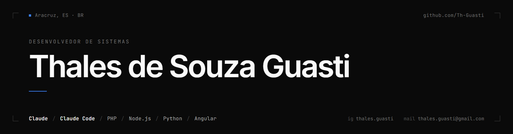
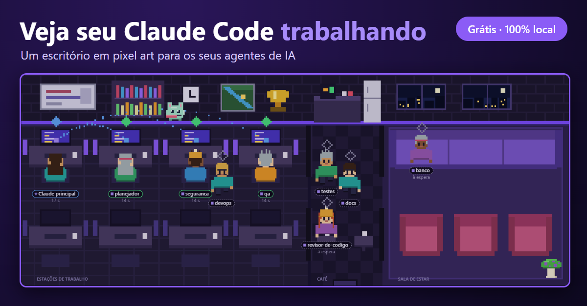

  

#

## Olá, eu sou o Thales 👋

**Desenvolvedor de Sistemas** | PHP, Node.js e Python | Integrações com HCM Senior, GED e APIs externas

Desenvolvo sistemas internos que conectam operações e sistemas corporativos (Senior ERP, GED) via API, do levantamento de requisito até a entrega em produção. Também mantenho e crio automações em Python e APIs em Node.

📍 Aracruz, Espírito Santo, Brasil

- 💼 **Hoje:** Assistente de TI no **Grupo Estel**, desenvolvendo integrações com web services do Senior ERP e GED, e um sistema de mobilização de colaboradores integrado a uma API externa
- 👨‍🏫 **Também:** professor de TI (Rede de Computadores) no Curso Técnico Ciclos
- 🎓 **Estudando:** pós-graduação em Desenvolvimento Full Stack (Descomplica), com foco em Java
- 🚀 **Projeto novo:** o [Escrithorius](#-projeto-em-destaque), um escritório virtual para ver o Claude Code trabalhando

#

### 🛠️ Stack

   
   
   
   
   
   
   
   
   
   
   
   
   
   

#

## ⭐ Projeto em destaque

### [Escrithorius: escritório virtual para o Claude Code](https://github.com/Th-Guasti/escrithorius)

App para Windows que mostra o Claude Code trabalhando, como um escritório em pixel art: cada projeto vira uma sala e cada agente vira uma pessoa, que corre para a mesa quando é chamada e vai ao café quando termina.

- Avisos do Windows quando um agente conclui
- 100% local e só leitura, com segredos mascarados antes de aparecer na tela
- Feito com Electron e JavaScript puro, com mais de 190 testes automatizados

👉 [Código](https://github.com/Th-Guasti/escrithorius) · [Baixar o .exe](https://github.com/Th-Guasti/escrithorius/releases/latest)

#

## 📂 Outros projetos

| Projeto | O que é | Tecnologias |
| --- | --- | --- |
| [Controle de gastos com ingredientes](https://github.com/Th-Guasti/projeto-calculo-de-gastos-com-ingredientes) | Sistema para controlar ingredientes, usos e estoque | Node.js, SQLite |
| [Simulador de balança Toledo (P06)](https://github.com/Th-Guasti/simulador-balanca-toleto-p06-csharp) | Simulador de balança eletrônica | C# |
| Fisgados | Aplicativo mobile que combina diversão com espiritualidade (front-end de algumas telas) | Flutter |

Também trabalhei em sistemas de empresas (como o Balanciore, na Laticínios Fiore, e integrações no Grupo Estel). Esses são projetos de empresa, sem código público.

#

## 💼 Experiência

- **Professor de TI** · Curso Técnico Ciclos (autônomo) · out/2026 até hoje
- **Assistente de TI** · Grupo Estel · fev/2026 até hoje: integrações com Senior ERP e GED via web services, sistema de mobilização de colaboradores integrado a API externa
- **Analista de sistemas** · Laticínios Fiore · mar/2025 a set/2025: desenvolvimento fullstack (Node.js, TOTVS Protheus), lançamento do site institucional e suporte técnico interno
- **Estagiário de TI** · IFES Santa Teresa · set/2023 a fev/2025: suporte e manutenção de laboratórios, atendimento de TI nos setores do campus
- **Desenvolvimento Flutter** · Desbravalink · jun/2024 a ago/2024: front-end de telas do app Fisgados (aprendizado voluntário)

## 🎓 Formação e certificações

- **Tecnologia em Sistemas para Internet** · IFES Santa Teresa · 2022 a 2025
- **Pós-graduação em Desenvolvimento Full Stack** · Descomplica · 2026 a 2027 (cursando)
- **Senior Sistemas:** LSP Básico, Gestão de Recrutamento e Seleção (ATS, Portal de Talentos)
- **Fluid API:** Foundation e Professional
- **Alura e Udemy:** Angular 19, Flutter, React, JavaScript orientado a objetos, Git e GitHub

#

### 🤝 Conecte-se comigo

#

   <a href="https://github.com/Th-Guasti">
   
   

#

<picture align="center">
  <source media="(prefers-color-scheme: dark)" srcset="https://raw.githubusercontent.com/Th-Guasti/Th-Guasti/output/github-contribution-grid-snake-dark.svg">
  <source media="(prefers-color-scheme: dark)" srcset="https://raw.githubusercontent.com/Th-Guasti/Th-Guasti/output/github-contribution-grid-snake.svg">
  
</picture>
